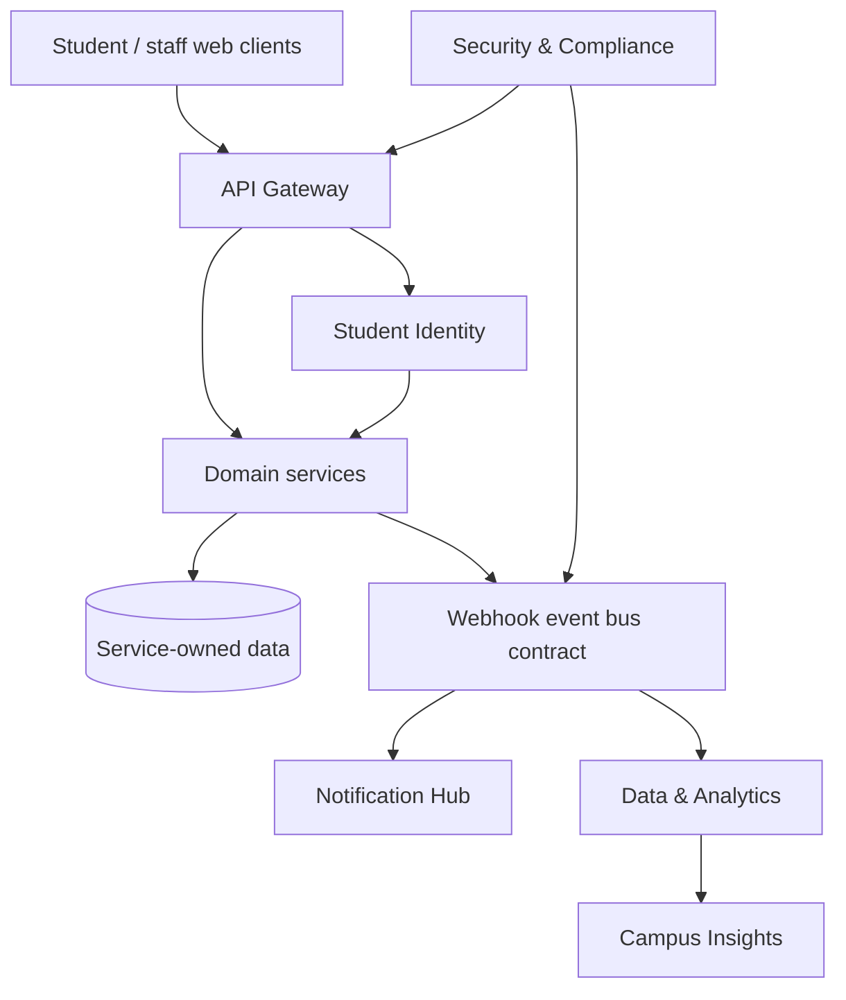

# PRD — University Digital Campus Platform

## 1. Product vision

University Digital Campus Platform is a connected set of 24 small, independently deployable student products. It gives a university one coherent digital experience while allowing each team to own a focused service, a clear data boundary, and a demonstrable integration. The platform serves students, instructors, staff, employers, alumni, and platform administrators.

The course outcome is not a collection of unrelated prototypes. Every team must deliver a useful vertical slice that can authenticate a real platform user, expose a documented REST API, exchange at least one event with another team, and keep working when its AI assistance is unavailable.

## 2. Platform scope and Pods

| Pod | Teams | Shared outcome |
| --- | --- | --- |
| 1. Identity & Academic Core | 01 Student Identity, 02 Course Catalog, 03 Enrollment, 04 Timetable & Room | A trusted academic foundation |
| 2. Learning Platform | 05 Assignment, 06 Submission, 07 Attendance, 08 Learning Assistant | A connected learning journey |
| 3. Campus Services | 09 Library, 10 Maintenance, 11 Transport & Parking, 12 Events & Clubs | Everyday campus operations |
| 4. Student Support | 13 Advising, 14 Helpdesk, 15 Scholarship, 16 Wellbeing | Accessible and private student support |
| 5. Career & Communication | 17 Internship, 18 Job Board, 19 Alumni Network, 20 Notification Hub | Career pathways and timely communication |
| 6. Innovation & Integration | 21 Data & Analytics, 22 Security & Compliance, 23 API Gateway, 24 Campus Insights | Platform reliability, governance, and insight |

Each team owns three primary screens, at least six REST operations, one inter-team webhook, one AI capability with a deterministic fallback, and seven or more automated tests.

## 3. Shared architecture



Services may use separate databases or schema namespaces, but no team may write directly to another team's data store. Teams integrate through public REST endpoints or versioned events. The API Gateway routes external requests, validates tokens, applies rate limits, exposes health checks, and publishes a service catalogue. Student Identity is the authoritative source for student ID, display name, roles, and consent-aware profile claims.

## 4. Integration and communication contract

### Synchronous requests

Use HTTPS REST and JSON, documented with OpenAPI 3.1. Every endpoint uses a versioned base path such as `/api/v1/...`, validates input, returns meaningful HTTP status codes, and includes a correlation ID. User-facing calls carry an Identity access token; service-to-service calls use a scoped machine credential. Do not share passwords or private profile fields in query strings.

### Asynchronous events

Publish signed webhooks for changes that another service should react to. Use the envelope below, retry failed delivery with exponential backoff, and make consumers idempotent using `eventId`.

```json
{
  "eventId": "uuid",
  "type": "enrollment.changed",
  "occurredAt": "ISO-8601",
  "source": "enrollment",
  "subject": "student:6631501001",
  "data": {}
}
```

Required flows: Student Identity serves all teams; Enrollment publishes `enrollment.changed` to Timetable & Room, Attendance, and Notification Hub; Assignment publishes `assignment.published` to Learning Assistant; Maintenance publishes status changes to Helpdesk and Notification Hub; Events & Clubs publishes reminders to Notification Hub; Internship and Job Board read approved profile claims from Identity. All material events are available to Data & Analytics, with privacy minimisation, and security-relevant events go to Security & Compliance.

## 5. Technology stack

Recommended stack: React + TypeScript for the web client; Cloudflare Workers or Node.js TypeScript services; REST/OpenAPI 3.1; D1/PostgreSQL/SQLite for relational service data; R2/S3-compatible storage for evidence documents; Cloudflare Queues or a webhook dispatcher for asynchronous delivery; Vitest/Jest plus Playwright for automated tests; GitHub Actions for CI. AI features may use an approved LLM behind a server-side endpoint with prompt logging that excludes sensitive data. Each feature must expose a rule-based or template-based fallback.

## 6. Security, privacy, and quality

Use least-privilege roles, server-side authorisation, audit logs for staff actions, input validation, CSRF protection where relevant, rate limits, and secrets stored outside source code. Wellbeing, scholarship, advising, and security data require stricter access controls and minimised analytics. Never place student records in public repositories or demo screenshots.

Definition of done: a deployed vertical slice; README and OpenAPI contract; 3 core screens; at least 6 API operations; a tested inbound or outbound event; AI plus fallback; 7 automated tests; accessibility checks for the primary flow; a short runbook covering health check, failure recovery, and ownership.

## 7. Team delivery sequence

Weeks 1–2 establish ownership, domain model, and APIs. Weeks 3–4 freeze a first contract and mock the consumer. Weeks 5–7 complete a connected vertical slice. Weeks 8–10 evaluate AI and fallback behaviour. Weeks 11–14 harden security, tests, observability, deployment, and handover. Contract changes are proposed through versioned OpenAPI/event schema pull requests and agreed with affected teams before release.
