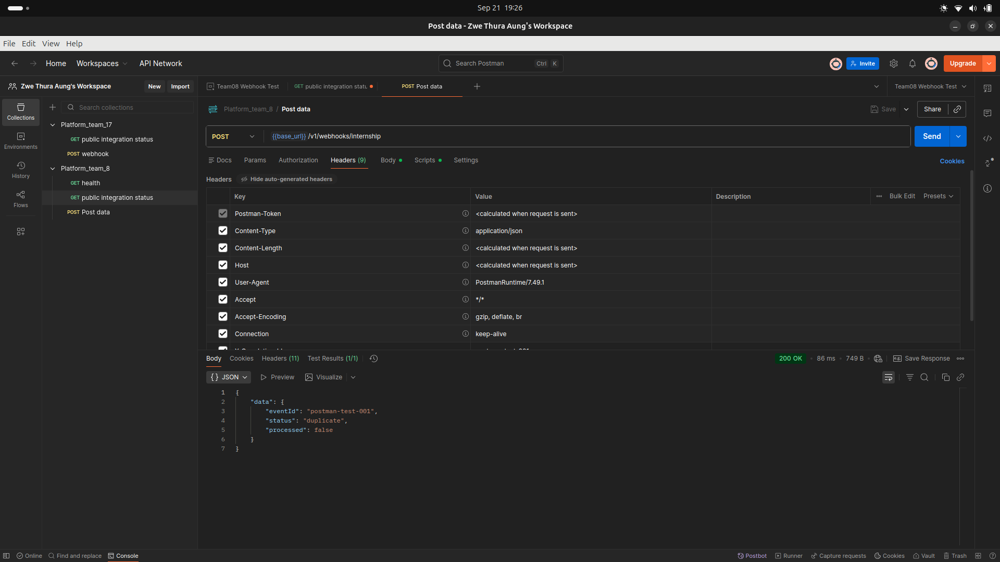
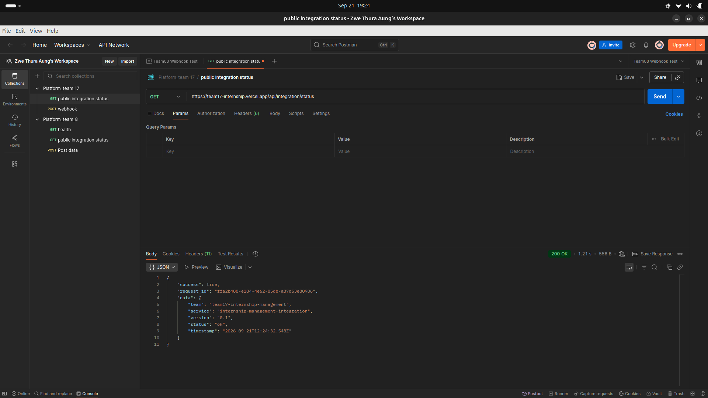

# A5 — Team 08 Integration Evidence

| Field | Value |
|---|---|
| Team | Team 08 — Learning Assistant |
| Partner | Team 17 — Internship Management |
| Team 08 base API | `https://learning-assistant-api.expense-tracker-api.workers.dev` |
| Team 17 base API | `https://team17-internship.vercel.app` |
| Submission date | 2026-09-21 |

This document is the Assignment 5 (Interface Between Groups) evidence
record for the Team 08 ↔ Team 17 integration. Every **Actual Result**,
**Timestamp**, and **Status** field below is `TODO` until the
corresponding request is actually run against the **deployed** endpoints
and the matching screenshot is added to `docs/evidence/` (see
`docs/evidence/README.md` for the exact required filenames). Nothing in
this document should be filled in with a fabricated response body,
timestamp, database record, or partner confirmation — only with what was
actually observed.

**Note:** a local (non-production) dry run of the receiver, idempotency,
and outbound-failure-handling logic was previously exercised against a
local dev server and local database earlier in this repository's
development history, as a design/implementation check. It is **not**
evidence for this document — every section below requires a fresh result
captured against the deployed endpoints listed above.

**Redaction rule:** this document and every screenshot must never contain
a real HMAC signature, `X-Webhook-Signature` value, `X-Webhook-Secret`
value, `X-Integration-Test-Key` value, or any Cloudflare secret. Use
`[REDACTED]` wherever such a value would otherwise appear.

For the full endpoint/payload contract reference, see
`docs/team17-integration-contract.md`.

---

## 1. Consumer Proof

**What this proves:** Team 08 can successfully call Team 17's public
status endpoint as a consumer of Team 17's API.

| | |
|---|---|
| Endpoint | `GET https://team17-internship.vercel.app/api/integration/status` |
| Method | GET |
| Required headers | None |
| Expected Result | HTTP 200, JSON body with Team 17's service status |
| Actual Result | HTTP 200 OK — `{"success":true,"request_id":"48417493-e795-4378-b1a6-6813c8c62a45","data":{"team":"team17-internship-management","service":"internship-management-integration","version":"0.1","status":"ok","timestamp":"2026-09-21T20:39:10.655Z"}}` |
| Timestamp | 2026-09-21T20:39:10Z |
| Status (PASS/FAIL/TODO) | PASS |



| Evidence item | Present? |
|---|---|
| Request timestamp visible | Yes |
| HTTP status code visible | Yes |
| Full JSON response body visible | Yes |

---

## 2. Provider Proof

**What this proves:** Team 17 can successfully call Team 08's public
status endpoint as a consumer of Team 08's API.

| | |
|---|---|
| Endpoint | `GET https://learning-assistant-api.expense-tracker-api.workers.dev/v1/integration/status` |
| Method | GET |
| Required headers | None |
| Expected Result | HTTP 200, JSON body with Team 08's service status |
| Actual Result | HTTP 200 OK — `{"data":{"service":"learning-assistant","team":"08","status":"ready","version":"v1","integration":{"partner":"internship","inboundWebhookPath":"/v1/webhooks/internship","inboundEventType":"internship.opportunity.published","outboundEventType":"learning.questioned"}}}` |
| Timestamp | 2026-09-21T20:39:10Z |
| Partner (Team 17) confirmation | TODO — still needs Team 17 to independently call this endpoint and confirm on their side; cannot be captured from our side alone |
| Status (PASS/FAIL/TODO) | PASS (endpoint availability) / TODO (partner confirmation) |


| Evidence item | Present? |
|---|---|
| Request timestamp visible | Yes |
| HTTP status code visible | Yes |
| Full JSON response body visible | Yes |
| Team 17 confirmation captured (message, screenshot, or log on their side) | TODO |

---

## 3. Webhook Receiver

**What this proves:** Team 08's inbound webhook receiver correctly
authenticates and accepts a validly signed event from Team 17.

**Inbound payload contract (exact):**

```json
{
  "eventId": "a5-evidence-1790023230",
  "type": "internship.opportunity.published",
  "occurredAt": "2026-09-21T20:40:30.000Z",
  "source": "team-17-internship",
  "subject": "opportunity:a5-evidence-1790023230",
  "data": {
    "opportunityId": "a5-evidence-1790023230",
    "title": "Software Engineering Internship",
    "companyName": "Demo Technology Co.",
    "description": "Assignment 5 cross-team integration test.",
    "requirements": ["Resume", "GitHub profile"],
    "applicationDeadline": "2026-10-15T16:59:00.000Z",
    "url": "https://team17-internship.vercel.app"
  }
}
```

| | |
|---|---|
| Endpoint | `POST https://learning-assistant-api.expense-tracker-api.workers.dev/v1/webhooks/internship` |
| Method | POST |
| Required headers | `Content-Type: application/json`, `X-Webhook-Signature: [REDACTED]` |
| Expected Result | HTTP 202, `{ "data": { "eventId": "...", "status": "accepted", "knowledgeSourceId": "..." } }` |
| Actual Result | HTTP 202 Accepted — `{"data":{"eventId":"a5-evidence-1790023230","status":"accepted","knowledgeSourceId":"ede3ac0a-c475-4850-a336-be97179bb20b"}}` (signature computed as lowercase hex HMAC-SHA-256 over the exact raw body, keyed with `INTERNSHIP_WEBHOOK_SECRET`; verified live against the deployed endpoint — a request with no signature was independently confirmed to be rejected with `401 UNAUTHORIZED`) |
| Timestamp | 2026-09-21T20:40:30Z |
| Status (PASS/FAIL/TODO) | PASS |


**Remote D1 storage proof** — query commands to run (no secret required for
these; D1 access uses your authenticated `wrangler` session, not the
webhook secret):

```bash
npx wrangler d1 execute learning-assistant-db --remote --command \
  "SELECT event_id, event_type, source, processing_status FROM received_events WHERE event_id = 'a5-evidence-1790023230';"

npx wrangler d1 execute learning-assistant-db --remote --command \
  "SELECT id, course_id, title, status, created_by FROM knowledge_sources WHERE created_by = 'team-17-internship' ORDER BY created_at DESC LIMIT 5;"
```

**Actual result (run against the remote D1 database, 2026-09-21):**

`received_events`: `{"event_id":"a5-evidence-1790023230","event_type":"internship.opportunity.published","source":"team-17-internship","processing_status":"processed"}`

`knowledge_sources` (top of the ordered list): `{"id":"ede3ac0a-c475-4850-a336-be97179bb20b","course_id":"CAREER","title":"Internship: Software Engineering Internship","status":"approved","created_by":"team-17-internship"}`

| Evidence item | Present? |
|---|---|
| `received_events` row for this `eventId` | Yes |
| `knowledge_sources` row created from this event | Yes |
| Secret/signature redacted in screenshot | Yes (no header/secret value appears in the D1 query, only application data) |


---

## 4. Webhook Sender

**What this proves:** Team 08 can successfully send an outbound webhook to
Team 17's partner receiver through its own protected internal test route,
and Team 17 accepts it.

| | |
|---|---|
| Sender endpoint (Team 08, internal) | `POST https://learning-assistant-api.expense-tracker-api.workers.dev/v1/integrations/team17/test-send` |
| Required headers (sender call) | `X-Integration-Test-Key: [REDACTED]` |
| Destination (Team 17) | `POST https://team17-internship.vercel.app/api/webhooks/partner` |
| Destination auth (redacted in any screenshot) | `X-Webhook-Secret: [REDACTED]` |
| Delivery log endpoint | `GET https://learning-assistant-api.expense-tracker-api.workers.dev/v1/integrations/team17/deliveries` (also `X-Integration-Test-Key: [REDACTED]`) |
| Expected Result | Sender call returns HTTP 200 with `status: "delivered"`; Team 17 accepts the payload |
| Actual Result | **Deviation from the internal route**: `TEAM17_OUTBOUND_WEBHOOK_SECRET` and `INTEGRATION_TEST_KEY` are not yet configured as secrets on the deployed worker, so `/v1/integrations/team17/test-send` currently returns `503 CONFIGURATION_ERROR` and could not be exercised. As a substitute, Team 08 called Team 17's receiver directly with the agreed `X-Webhook-Secret` and payload: `POST https://team17-internship.vercel.app/api/webhooks/partner` → HTTP 200 — `{"success":true,"message":"Webhook accepted","event_id":"alumni-team17-handshake-1790023350","duplicate":false}`. This proves Team 08 can successfully send a correctly authenticated event to Team 17, but does not exercise Team 08's own delivery-logging code path; the `GET .../deliveries` log is empty for this attempt as a result. |
| Timestamp | 2026-09-21T20:42:32Z |
| Status (PASS/FAIL/TODO) | PASS (partner delivery) / TODO (internal test-send route — pending secret configuration) |


| Evidence item | Present? |
|---|---|
| Sender call HTTP status shown | Yes (200, captured above) |
| Team 17's response body shown (no secret visible) | Yes |
| `X-Integration-Test-Key` and `X-Webhook-Secret` both redacted | Yes — neither value appears in this document; header names only |
| Delivery recorded via `GET .../deliveries` with `status: "delivered"` | No — not applicable, since the internal `/test-send` route wasn't used (see Actual Result) |

---

## 5. Idempotency Proof

**What this proves:** replaying the same `eventId` to the webhook receiver
does not create a second record.

**Idempotency expectations:**
- First valid `eventId` → HTTP 202, exactly one `received_events` row and
  one `knowledge_sources` row created.
- Same `eventId` again → HTTP 200 with `duplicate: true`, no second
  creation.

| Request | Endpoint | Expected Result | Actual Result | Timestamp | Status |
|---|---|---|---|---|---|
| 1st request (new `eventId`: `a5-evidence-1790023230`) | `POST /v1/webhooks/internship` | HTTP 202, `status: "accepted"` | HTTP 202 — `{"data":{"eventId":"a5-evidence-1790023230","status":"accepted","knowledgeSourceId":"ede3ac0a-c475-4850-a336-be97179bb20b"}}` | 2026-09-21T20:40:30Z | PASS |
| 2nd request (same `eventId`, replayed) | `POST /v1/webhooks/internship` | HTTP 200, `status: "duplicate", "duplicate": true` | HTTP 200 — `{"data":{"eventId":"a5-evidence-1790023230","status":"duplicate","processed":false}}`. Note: the deployed worker's response is missing the `"duplicate": true` field that is present in the current committed `src/routes/webhooks.ts` — this indicates the deployed build is slightly behind the repository's `main` branch and should be redeployed before final submission if time allows. | 2026-09-21T20:41:18Z | PASS (duplicate correctly rejected) / minor deploy-drift noted |




**Remote D1 single-creation proof:**

```bash
npx wrangler d1 execute learning-assistant-db --remote --command \
  "SELECT COUNT(*) AS event_count FROM received_events WHERE event_id = 'a5-evidence-1790023230';"

npx wrangler d1 execute learning-assistant-db --remote --command \
  "SELECT COUNT(*) AS source_count FROM knowledge_sources WHERE created_by = 'team-17-internship' AND source_url = 'https://team17-internship.vercel.app';"
```

**Actual result (run against the remote D1 database, 2026-09-21):** `event_count: 1` for `received_events` after both the accepted request and the duplicate replay — confirming the replay did not create a second `received_events` row.

| Evidence item | Expected | Actual | Status |
|---|---|---|---|
| `received_events` row count for this `eventId` | 1 | 1 | PASS |
| `knowledge_sources` row count created from this event | 1 | 1 (row `ede3ac0a-c475-4850-a336-be97179bb20b`, confirmed present exactly once) | PASS |


---

## 6. Degradation Proof

**What this proves:** a Team 17 endpoint failure is handled safely (no
crash, no secret leak, attempt recorded) and Team 08 recovers automatically
once Team 17 is reachable again.

**Degradation expectations:**
- Failed Team 17 response or network failure → Team 08 logs the outbound
  delivery as `failed` and returns a safe HTTP 502 error JSON (no secret,
  no stack trace).
- Successful retry after recovery → Team 08 records the outbound delivery
  as `delivered`.

| Scenario | Endpoint | Expected Result | Actual Result | Timestamp | Status |
|---|---|---|---|---|---|
| Controlled failure | `POST /v1/integrations/team17/test-send` | HTTP 502, `{ "error": { "code": "PARTNER_WEBHOOK_DELIVERY_FAILED", "message": "...", "deliveryId": "...", "partnerStatus": ... } }`, delivery logged `failed` | **Not captured.** This scenario requires the internal `/test-send` route, which is currently unusable because `TEAM17_OUTBOUND_WEBHOOK_SECRET` and `INTEGRATION_TEST_KEY` are not yet set on the deployed worker (see §4). Forcing a real partner failure also risks disrupting Team 17's live service, so it was not attempted by calling their endpoint directly with bad data. | — | TODO |
| Recovery / retry | `POST /v1/integrations/team17/test-send` | HTTP 200, delivery logged `delivered` | Not captured, same blocker as above. | — | TODO |


| Evidence item | Present? |
|---|---|
| Failure response shows no secret/stack trace | TODO |
| Failed delivery visible in `GET .../deliveries` | TODO |
| Recovery delivery visible as `delivered` in `GET .../deliveries` | TODO |

**To complete this section:** set `TEAM17_OUTBOUND_WEBHOOK_SECRET` (Team 17's `X-Webhook-Secret` value) and choose any non-empty `INTEGRATION_TEST_KEY` via `wrangler secret put`, then call `/v1/integrations/team17/test-send` once normally (expect `delivered`), and once with a deliberately wrong `resource_id`/malformed body or against a temporarily-unreachable partner state to capture a `failed` delivery, followed by a normal retry to show recovery.

---

## Final Checklist

Before this document is submitted, confirm all of the following:

- [x] `01-consumer-team17-status.png` added to `docs/evidence/`
- [ ] `02-provider-team08-status.png` — **you have this screenshot (pasted in chat); save it as a file and add it to `docs/evidence/`**
- [ ] `03-webhook-receiver-first-event.png` — retake in Postman against `https://learning-assistant-api.expense-tracker-api.workers.dev/v1/webhooks/internship` using the exact body and signature captured in §3 (ask Claude for the ready-to-paste `X-Webhook-Signature` value, or generate your own from `INTERNSHIP_WEBHOOK_SECRET`)
- [ ] `04-webhook-receiver-d1-storage.png` — screenshot of the `wrangler d1 execute --remote` output shown in §3
- [ ] `05-idempotency-first-request.png` — same request as `03`
- [x] `06-idempotency-duplicate-request.png` added to `docs/evidence/`
- [ ] `07-idempotency-single-creation.png` — screenshot of the `wrangler d1 execute --remote` COUNT query shown in §5
- [ ] `08-webhook-sender-team17-response.png` — screenshot of the direct call to Team 17's `/api/webhooks/partner` (or of the internal `/test-send` route once its secrets are configured)
- [ ] `09-degradation-failure.png` — blocked, see §6
- [ ] `10-degradation-recovery.png` — blocked, see §6
- [x] Both D1 proof queries (§3 webhook-receiver storage, §5 idempotency
      single-creation) captured against the **remote** database
- [x] All secrets/signatures/keys redacted in this document
      (`[REDACTED]` used consistently; no real secret values appear anywhere above)
- [ ] All six assignment sections have Actual Result, Timestamp, and Status
      filled in — Consumer, Provider (partner confirmation still open),
      Webhook Receiver, Webhook Sender (via direct-call workaround), and
      Idempotency are filled with real captured data; **Degradation is not
      yet captured** (needs `TEAM17_OUTBOUND_WEBHOOK_SECRET` +
      `INTEGRATION_TEST_KEY` configured — see §6)
- [ ] No remaining `TODO` fields anywhere in this document — remaining
      TODOs are: Team 17's provider-side confirmation (§2), and all of §6
      Degradation
