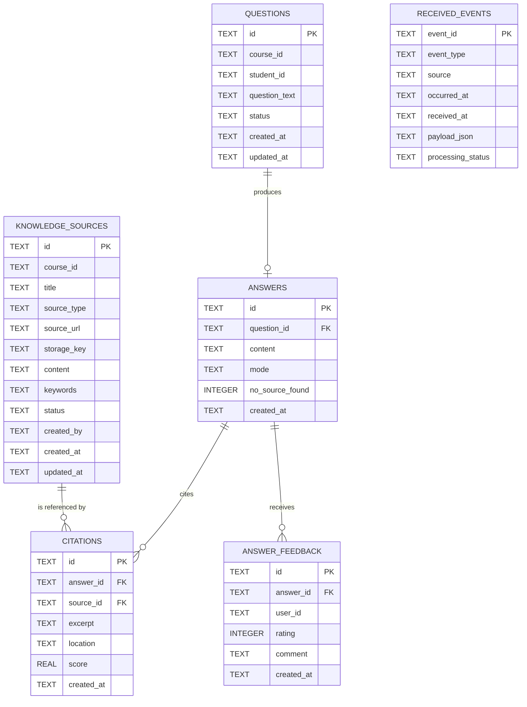

# Assignment #3: Data and Query Design
## Learning Assistant — Team 08

---

## 1. Introduction

Learning Assistant is a course question-answering service built as part of a
larger university Digital Campus Platform. It lets a student ask a
course-scoped question and receive an answer that is grounded **only** in
materials an instructor or teaching assistant has explicitly approved for
that course.

Two properties define the product:

- **Every substantive answer carries citations.** An answer is either backed
  by one or more approved knowledge sources (with excerpts a student can
  verify), or the system honestly reports that it found nothing and points
  the student to their instructor — it never invents an answer.
- **It is one service among many.** In the Digital Campus Platform, each
  team owns one focused service with its own data boundary, integrating
  with the rest of the platform through REST APIs and versioned webhook
  events rather than shared databases.

This assignment covers the data and query design for that service: the
relational schema, why the chosen database fits, and the REST API that
reads and writes it.

---

## 2. Database Choice

**Cloudflare D1** (a managed, serverless SQLite database) was chosen for
Learning Assistant.

| Reason | Why it matters here |
|---|---|
| SQLite-compatible relational database | The domain is inherently relational: a course has sources; a question has (at most) one answer; an answer has citations and feedback. Foreign keys and `UNIQUE`/`CHECK` constraints express these rules directly in the schema instead of only in application code. |
| Native Cloudflare Worker integration | The API is a Hono app on Cloudflare Workers. D1 is bound directly into the Worker (`env.learning_assistant_db`) with no separate network hop, connection pool, or driver to manage. |
| Simple migrations for local and remote | `wrangler d1 migrations apply ... --local` / `--remote` runs the same numbered SQL migration file against a local simulated database or the real remote one, with no extra tooling. |
| Parameterized SQL, indexes, foreign keys, CHECK constraints | All of D1's SQL query surface is standard SQLite: prepared statements with bound parameters, `CREATE INDEX`, `FOREIGN KEY ... ON DELETE ...`, and column-level `CHECK` constraints — everything this schema needed. |
| Cost / operational simplicity for a student MVP | D1 has a workable free tier, requires no server to provision or patch, and scales down to zero between requests — appropriate for a course project with a small number of courses and students. |

**A realistic limitation:** D1 is well suited to this relational MVP, but it
has no native vector/embedding index. If the project later adds semantic
(meaning-based) retrieval instead of the current keyword search, that would
need an additional component (e.g. Cloudflare Vectorize) — D1 alone would
not cover it.

---

## 3. Data Ownership and Boundaries

- Learning Assistant owns **its own** D1 database and schema exclusively.
  No other Digital Campus Platform service reads or writes these tables
  directly, and this service does not reach into any other service's data
  store either.
- `course_id`, `student_id`, `user_id`, and `created_by` are **external
  identifiers**: they are supplied by other platform services (a Course
  Catalog service, a Student Identity service) and are stored here only as
  opaque foreign references, not resolved or duplicated locally.
- Cross-service integration is expected to happen through **REST APIs and
  signed webhook events**, never through direct database access across
  service boundaries.
- The `received_events` table exists to support this: it is an idempotency
  ledger for **future** inbound webhook processing (for example, an
  `assignment.published` event from an Assignment service). Its primary key
  is the event id, so a consumer can check "have I already processed this
  event?" before doing any work, making redelivery safe.

---

## 4. Entity Relationship Diagram



*(Diagram source also stored standalone at
`docs/diagrams/learning-assistant-er-diagram.mmd`.)*

Reading the diagram:

- A **question** produces at most **one answer** (zero while still
  processing, one once answered) — enforced by `answers.question_id` being
  both a foreign key and `UNIQUE`.
- An **answer** cites **zero or more citations** (zero exactly when
  `no_source_found = 1`).
- A **knowledge source** can be referenced by **zero or more citations**
  across different answers/questions.
- An **answer** can receive **zero or more feedback** records (one per
  user, enforced at the application layer for this MVP).
- **`received_events`** has no foreign-key relationship to any other
  table — it is an independent idempotency ledger for future inbound
  webhook processing.

---

## 5. Relational Schema

The full, authoritative schema lives in
`migrations/0001_initial_learning_assistant_schema.sql`. This section
explains each table.

### `knowledge_sources`

Instructor/TA-approved learning material for one course — the only thing
the fallback search is ever allowed to draw an answer from.

| Column | Type | Constraints | Purpose |
|---|---|---|---|
| `id` | TEXT | PRIMARY KEY | Source identifier (UUID) |
| `course_id` | TEXT | NOT NULL | Owning course (external identifier) |
| `title` | TEXT | NOT NULL | Display title, also searched by the fallback matcher |
| `source_type` | TEXT | NOT NULL | e.g. `document`, `link`, `text` |
| `source_url` | TEXT | nullable | Set when the source is a link |
| `storage_key` | TEXT | nullable | Set when the original file is stored elsewhere (e.g. object storage) |
| `content` | TEXT | nullable | Extracted/plain text used for matching; may be absent at creation time |
| `keywords` | TEXT | nullable | Comma-separated keyword list, also searched by the fallback matcher |
| `status` | TEXT | NOT NULL, DEFAULT `'approved'`, `CHECK (status IN ('draft','approved','archived'))` | Lifecycle state |
| `created_by` | TEXT | NOT NULL | Instructor/TA identifier (external) |
| `created_at` / `updated_at` | TEXT | NOT NULL | UTC ISO-8601 timestamps |

**Soft archive:** `DELETE /v1/sources/:id` never removes this row. It sets
`status = 'archived'` and refreshes `updated_at`. An archived source is
immediately excluded from future retrieval (it is not `approved`), while
any citation that already points to it is preserved as history.

### `questions`

A student's course-scoped question and its lifecycle.

| Column | Type | Constraints | Purpose |
|---|---|---|---|
| `id` | TEXT | PRIMARY KEY | Question identifier (UUID) |
| `course_id` | TEXT | NOT NULL | Course the question was asked in |
| `student_id` | TEXT | NOT NULL | Asking student (external identifier, taken from identity headers — never from the request body) |
| `question_text` | TEXT | NOT NULL | The question itself |
| `status` | TEXT | NOT NULL, DEFAULT `'pending'`, `CHECK (status IN ('pending','answered','no_source_found','failed'))` | Lifecycle state |
| `created_at` / `updated_at` | TEXT | NOT NULL | UTC ISO-8601 timestamps |

A question is inserted as `pending`, then updated to `answered` or
`no_source_found` once the fallback search completes (see §7/§8).

### `answers`

The one stored response to a question.

| Column | Type | Constraints | Purpose |
|---|---|---|---|
| `id` | TEXT | PRIMARY KEY | Answer identifier (UUID) |
| `question_id` | TEXT | NOT NULL, **UNIQUE**, `FOREIGN KEY → questions(id) ON DELETE CASCADE` | One answer per question |
| `content` | TEXT | NOT NULL | The templated answer text |
| `mode` | TEXT | NOT NULL, `CHECK (mode IN ('ai','fallback'))` | How the answer was produced — currently always `fallback` in this implementation; `ai` is reserved for a future generation path |
| `no_source_found` | INTEGER | NOT NULL, DEFAULT `0`, `CHECK (no_source_found IN (0,1))` | `1` when nothing approved matched |
| `created_at` | TEXT | NOT NULL | UTC ISO-8601 timestamp |

`question_id UNIQUE` plus the foreign key is what guarantees "at most one
answer per question" at the database level, not only in application code.

### `citations`

Evidence linking an answer back to the source excerpt it came from.

| Column | Type | Constraints | Purpose |
|---|---|---|---|
| `id` | TEXT | PRIMARY KEY | Citation identifier (UUID) |
| `answer_id` | TEXT | NOT NULL, `FOREIGN KEY → answers(id) ON DELETE CASCADE` | Owning answer |
| `source_id` | TEXT | NOT NULL, `FOREIGN KEY → knowledge_sources(id) ON DELETE RESTRICT` | Cited source |
| `excerpt` | TEXT | NOT NULL | Short quoted/derived text a student can verify against the source |
| `location` | TEXT | nullable | Reserved for a page/section reference |
| `score` | REAL | nullable | Fallback-search match score, for ranking/debugging |
| `created_at` | TEXT | NOT NULL | UTC ISO-8601 timestamp |

The two foreign keys use different `ON DELETE` behavior deliberately:
`CASCADE` on `answer_id` (a citation is meaningless without its answer),
`RESTRICT` on `source_id` (a source that is still cited cannot simply
disappear — it must be archived, not deleted, preserving the citation's
integrity).

### `answer_feedback`

A user's rating of an answer.

| Column | Type | Constraints | Purpose |
|---|---|---|---|
| `id` | TEXT | PRIMARY KEY | Feedback identifier (UUID) |
| `answer_id` | TEXT | NOT NULL, `FOREIGN KEY → answers(id) ON DELETE CASCADE` | Rated answer |
| `user_id` | TEXT | NOT NULL | Rating user (external identifier, from identity headers) |
| `rating` | INTEGER | NOT NULL, `CHECK (rating BETWEEN 1 AND 5)` | 1–5 rating |
| `comment` | TEXT | nullable | Optional free-text comment |
| `created_at` | TEXT | NOT NULL | UTC ISO-8601 timestamp |

### `received_events`

Idempotency ledger for future signed inbound webhooks.

| Column | Type | Constraints | Purpose |
|---|---|---|---|
| `event_id` | TEXT | **PRIMARY KEY** | The idempotency key |
| `event_type` | TEXT | NOT NULL | e.g. `assignment.published` |
| `source` | TEXT | NOT NULL | Publishing service |
| `occurred_at` | TEXT | NOT NULL | When the source event happened |
| `received_at` | TEXT | NOT NULL | When this service received it |
| `payload_json` | TEXT | NOT NULL | Raw event payload |
| `processing_status` | TEXT | NOT NULL, DEFAULT `'received'`, `CHECK (processing_status IN ('received','processed','failed'))` | Processing lifecycle |

Because `event_id` is the primary key, inserting the same event twice is a
constraint violation the consumer can detect and treat as "already
handled" rather than reprocessing it.

### Indexes

| Index | Table (columns) | Why |
|---|---|---|
| `idx_knowledge_sources_course_status` | `knowledge_sources(course_id, status)` | The listing endpoint always filters by course **and** `status = 'approved'` |
| `idx_knowledge_sources_course_title` | `knowledge_sources(course_id, title)` | Listing is ordered by title within a course |
| `idx_questions_student_created` | `questions(student_id, created_at)` | Looking up a student's own question history |
| `idx_questions_course_created` | `questions(course_id, created_at)` | Looking up a course's question history |
| `idx_citations_answer_id` | `citations(answer_id)` | Fetching all citations for one answer (used by `GET /v1/questions/:id`) |
| `idx_citations_source_id` | `citations(source_id)` | Finding all citations that reference a given source |
| `idx_answer_feedback_answer_id` | `answer_feedback(answer_id)` | Fetching feedback for an answer |
| `idx_received_events_type_received` | `received_events(event_type, received_at)` | Future: scanning recent events by type |

---

## 6. Database Migration and Deployment

**Migration file:** `migrations/0001_initial_learning_assistant_schema.sql`
— a single, additive migration creating all six tables and eight indexes
described above.

### Local migration verification (actually run)

```bash
rm -rf .wrangler/state/v3/d1
npx wrangler d1 migrations apply learning-assistant-db --local
```

Outcome: **15 SQL statements executed successfully** (6 `CREATE TABLE` + 8
`CREATE INDEX` + 1 internal migration-tracking insert); the migration was
recorded as applied. Table and index presence, plus the `questions.status`
default (`pending`) and `received_events.processing_status` default
(`received`), were then independently confirmed by inserting rows that
omit those columns and reading the defaulted value back. Full detail is in
`docs/assignment-3-evidence/local-schema-verification.txt`.

### Remote migration procedure

The remote database (`learning-assistant-db`) is deployed using the same
migration file, via:

```bash
npx wrangler login
npx wrangler d1 migrations apply learning-assistant-db --remote
npx wrangler d1 execute learning-assistant-db --remote --command "SELECT name, type FROM sqlite_master WHERE type IN ('table', 'index') ORDER BY type, name;"
```

> **Remote deployment status: Confirmed.** With team approval, the above
> commands were run against the real `learning-assistant-db` database.
> `wrangler` reported **"No migrations to apply!"** — the remote database
> already had migration `0001_initial_learning_assistant_schema.sql`
> recorded as applied (most likely from an earlier deploy by a teammate on
> this shared repository, prior to this session). The remote schema was
> then independently verified with the `SELECT ... sqlite_master` query
> above: all **6 application tables** and all **8 explicit indexes** are
> present on the remote database, exactly matching the local schema. No
> destructive action occurred and no data was changed
> (`changed_db: false`, `rows_written: 0`). Full detail in
> `docs/assignment-3-evidence/remote-migration-verification.txt`.

---

## 7. API and CRUD Design

All endpoints are under the `/v1` prefix.

| Method | Path | Role | Purpose |
|---|---|---|---|
| GET | `/v1/health` | none | Liveness check |
| POST | `/v1/sources` | instructor | Create a knowledge source |
| PATCH | `/v1/sources/{id}` | instructor | Update a knowledge source |
| DELETE | `/v1/sources/{id}` | instructor | Archive (soft delete) a knowledge source |
| GET | `/v1/courses/{courseId}/sources` | student, instructor | List a course's approved sources |
| POST | `/v1/questions` | student | Ask a question; get a fallback answer + citations |
| GET | `/v1/questions/{id}` | owning student, instructor | Read a question with its answer and citations |
| POST | `/v1/answers/feedback` | student, instructor | Rate an answer (1–5) |

### CRUD mapped onto the `sources` resource

| Operation | Endpoint | Notes |
|---|---|---|
| **Create** | `POST /v1/sources` | Instructor only; `created_by` is taken from the identity header, never the body |
| **Read** | `GET /v1/courses/{courseId}/sources` | Returns only `status = 'approved'` sources for that course |
| **Update** | `PATCH /v1/sources/{id}` | Instructor only; updates only the supplied fields plus `updated_at`; `courseId`/`createdBy` cannot be changed here |
| **Archive** (in place of hard Delete) | `DELETE /v1/sources/{id}` | Instructor only; see below |

**`DELETE` is intentionally a soft archive, not a hard delete:**

- The row is never physically removed.
- `status` becomes `'archived'` and `updated_at` is refreshed.
- The source immediately disappears from future
  `GET /v1/courses/{courseId}/sources` results (which only return
  `approved` sources).
- Any citation already pointing at it is preserved — historic evidence in
  an answer a student already received is not retroactively invalidated.
- The operation is idempotent: archiving an already-archived source still
  returns `200` with that source, not an error.

---

## 8. API Demonstration

All examples below were run locally against `npx wrangler dev --local`
using the fictional course `SE101` and fictional users `instructor-demo`,
`student-demo-a`, `student-demo-b`. Full request/response evidence is in
`docs/assignment-3-evidence/api-demo-requests.md` and
`api-demo-responses.md`.

**Temporary development headers.** Every `/v1` route except `/v1/health`
requires `x-user-id` and `x-user-role` (`student` or `instructor`). These
are **scaffolding only** — there is no signature or token verification —
and are intended to be replaced by real Student Identity token validation
later. Missing/invalid headers return `401`; a disallowed role returns
`403`.

### Health

```bash
curl -s http://127.0.0.1:8787/v1/health
```
```json
{"status":"ok","service":"learning-assistant"}
```

### Create a source

```bash
curl -s -X POST http://127.0.0.1:8787/v1/sources \
  -H 'x-user-id: instructor-demo' -H 'x-user-role: instructor' \
  -H 'Content-Type: application/json' \
  -d '{
    "courseId": "SE101",
    "title": "Week 3 REST API Lecture Notes",
    "sourceType": "document",
    "sourceUrl": "https://example.edu/se101/week-3-rest",
    "content": "REST is an architectural style for networked applications. REST APIs commonly use HTTP methods such as GET, POST, PATCH, and DELETE.",
    "keywords": ["REST", "API", "HTTP", "GET", "POST"],
    "status": "approved"
  }'
```
```json
{
  "data": {
    "id": "<source-id>",
    "courseId": "SE101",
    "title": "Week 3 REST API Lecture Notes",
    "sourceType": "document",
    "sourceUrl": "https://example.edu/se101/week-3-rest",
    "storageKey": null,
    "content": "REST is an architectural style for networked applications. REST APIs commonly use HTTP methods such as GET, POST, PATCH, and DELETE.",
    "keywords": "REST, API, HTTP, GET, POST",
    "status": "approved",
    "createdBy": "instructor-demo",
    "createdAt": "2026-09-20T16:36:49.397Z",
    "updatedAt": "2026-09-20T16:36:49.397Z"
  }
}
```
`HTTP 201`.

### List approved sources (a draft source stays hidden)

```bash
curl -s http://127.0.0.1:8787/v1/courses/SE101/sources \
  -H 'x-user-id: student-demo-a' -H 'x-user-role: student'
```
```json
{ "data": { "items": [ { "id": "<source-id>", "status": "approved", "...": "..." } ], "count": 1 } }
```
`HTTP 200`. A second source created with `"status": "draft"` in the same
run does **not** appear in this list.

### Update a source

```bash
curl -s -X PATCH http://127.0.0.1:8787/v1/sources/<source-id> \
  -H 'x-user-id: instructor-demo' -H 'x-user-role: instructor' \
  -H 'Content-Type: application/json' \
  -d '{ "title": "Week 3 REST API Lecture Notes (Revised)", "keywords": ["REST","API","HTTP","GET","POST","PATCH","DELETE"] }'
```
```json
{ "data": { "id": "<source-id>", "title": "Week 3 REST API Lecture Notes (Revised)", "keywords": "REST, API, HTTP, GET, POST, PATCH, DELETE", "status": "approved", "updatedAt": "2026-09-20T16:37:00.989Z", "...": "..." } }
```
`HTTP 200`.

### Archive a source

```bash
curl -s -X DELETE http://127.0.0.1:8787/v1/sources/<source-id> \
  -H 'x-user-id: instructor-demo' -H 'x-user-role: instructor'
```
```json
{ "data": { "id": "<source-id>", "status": "archived", "...": "..." } }
```
`HTTP 200`. Listing the course's sources again afterward returns
`{ "data": { "items": [], "count": 0 } }` — the archived source is gone
from retrieval. Repeating the same `DELETE` returns `200` again with the
already-archived source (idempotent).

### Matching question → fallback answer with a citation

```bash
curl -s -X POST http://127.0.0.1:8787/v1/questions \
  -H 'x-user-id: student-demo-a' -H 'x-user-role: student' \
  -H 'Content-Type: application/json' \
  -d '{ "courseId": "SE101", "questionText": "What is REST and which HTTP methods are commonly used?" }'
```
```json
{
  "data": {
    "question": { "id": "<question-id>", "status": "answered", "...": "..." },
    "answer": {
      "id": "<answer-id>",
      "content": "Based on the approved course materials, the following source(s) appear relevant to your question:\n\n1. Week 3 REST API Lecture Notes (Revised) — \"REST is an architectural style for networked applications. REST API…\"",
      "mode": "fallback",
      "noSourceFound": false
    },
    "citations": [
      { "id": "<citation-id>", "sourceId": "<source-id>", "excerpt": "REST is an architectural style for networked applications. REST API…", "score": 16 }
    ],
    "note": "This is a deterministic keyword search over approved course materials, not an AI-generated explanation."
  }
}
```
`HTTP 201`.

### No-source-found question

```bash
curl -s -X POST http://127.0.0.1:8787/v1/questions \
  -H 'x-user-id: student-demo-a' -H 'x-user-role: student' \
  -H 'Content-Type: application/json' \
  -d '{ "courseId": "SE101", "questionText": "Where can I check my exam schedule?" }'
```
```json
{
  "data": {
    "question": { "id": "<question-id>", "status": "no_source_found", "...": "..." },
    "answer": {
      "content": "I could not find an answer in the approved materials for this course. Please check with your instructor.",
      "mode": "fallback",
      "noSourceFound": true
    },
    "citations": [],
    "note": "This is a deterministic keyword search over approved course materials, not an AI-generated explanation."
  }
}
```
`HTTP 201`. No invented answer, no citations.

### Question authorization

| Caller | Result |
|---|---|
| `student-demo-a` (the asking student) | `HTTP 200` |
| `student-demo-b` (a different student) | `HTTP 403 FORBIDDEN` |
| `instructor-demo` | `HTTP 200` |

### Feedback

```bash
curl -s -X POST http://127.0.0.1:8787/v1/answers/feedback \
  -H 'x-user-id: student-demo-a' -H 'x-user-role: student' \
  -H 'Content-Type: application/json' \
  -d '{ "answerId": "<answer-id>", "rating": 5, "comment": "The cited source was helpful." }'
```
```json
{ "data": { "id": "<feedback-id>", "answerId": "<answer-id>", "userId": "student-demo-a", "rating": 5, "comment": "The cited source was helpful.", "createdAt": "2026-09-20T16:37:15.019Z" } }
```
`HTTP 201`.

---

## 9. Data Quality, Security, and Integrity

- **Request validation.** Small, dependency-free helpers reject malformed
  JSON, non-object bodies, empty required strings, and wrong field types
  before any database access (`400 VALIDATION_ERROR`).
- **Temporary role-based authorization.** `x-user-id` / `x-user-role`
  middleware rejects missing/invalid identity (`401 UNAUTHORIZED`) and a
  route-level role guard rejects a disallowed role (`403 FORBIDDEN`) —
  e.g. a student cannot create, update, or archive a source.
- **Student question ownership.** A student can only read their own
  question; an instructor can read any question in a course. This is
  enforced server-side, not left to the client.
- **Instructor-only source management.** Creating, updating, and archiving
  knowledge sources is restricted to the `instructor` role.
- **Parameterized SQL only.** Every query uses D1's bound-parameter
  `prepare(...).bind(...)` API; no string concatenation into SQL. Dynamic
  `PATCH` updates build their column list from a fixed, explicit whitelist,
  never from arbitrary client-supplied keys.
- **Foreign keys and CHECK constraints.** Relationships (`answers →
  questions`, `citations → answers`/`knowledge_sources`, `answer_feedback →
  answers`) and finite value sets (`status`, `mode`, `rating` range) are
  enforced by the database itself, not only by application code — verified
  directly (see §10).
- **Correlation IDs.** Every response carries an `x-correlation-id` header
  (echoed from the request or generated), and every error body includes
  the same value, to make later log correlation possible.
- **Archived-source behavior.** An archived source is excluded from all
  future retrieval and matching, while citations that already reference it
  remain intact — history is preserved, not deleted.
- **Approved-source-only fallback retrieval.** The fallback search only
  ever reads `status = 'approved'` sources for the question's own course;
  `draft` and `archived` sources are never searched or cited.
- **No source means no invented answer.** When nothing matches, the system
  returns a fixed, honest "not found in approved materials" message with
  no citations, rather than guessing.

---

## 10. Testing and Verification

- **Type check:** `npm run typecheck` → **pass**, no errors.
- **Automated tests:** `npm test` → **47 / 47 passing** across 6 test
  files (pure validation-helper tests, deterministic fallback-search-logic
  tests, a pure question-ownership-authorization test, and Hono route
  tests covering the 401/403/400/correlation-id paths that resolve before
  any database access).
- **Local migration:** applied cleanly to a fresh local D1 (`--local`) —
  15 statements, all six tables and eight indexes present; the
  `questions.status = 'pending'` and `received_events.processing_status =
  'received'` defaults were confirmed by inserting rows that omit those
  columns and reading the value back, not only by reading the schema text.
- **Local API smoke test:** all seven business endpoints plus health were
  exercised end-to-end against a real local D1 database (not mocked),
  covering: source create/list/update/archive/idempotent-re-archive,
  draft-exclusion from listing, a matching question producing a fallback
  answer with a citation, a genuinely non-matching question producing the
  safe no-source response with empty citations, question-ownership
  authorization (owner / other student / instructor), and feedback
  creation. Full evidence in `docs/assignment-3-evidence/`.
- **Known limitation — plain Node Vitest vs. live D1.** The project's test
  setup runs Vitest in a plain Node environment (no
  `@cloudflare/vitest-pool-workers`), so the automated test suite does not
  exercise the database-backed success paths (e.g. an actual `201` from
  `POST /v1/sources` persisting a row) — those paths were instead verified
  manually via the local API smoke test above, against a real local D1
  database. The 47 automated tests cover pure logic (validation, fallback
  search scoring, question-ownership rules) and every route's
  pre-database-access path (auth, role checks, body validation,
  correlation-id propagation).
- **Known limitation — simple keyword matching.** The fallback matcher does
  case-insensitive **substring** matching on tokens of length ≥ 2. This is
  intentionally simple (per the product's own scope), but it means a very
  common short token (e.g. "is") can occasionally match incidentally
  against unrelated text that happens to contain that substring (e.g. the
  word "revised" contains "is"). This did not affect the demonstrated
  no-source-found example, which uses a question with no overlapping terms
  at all, but it is a known characteristic of the current matching
  approach worth keeping in mind.
- **Remote migration and schema verification:** performed, with explicit
  team approval — see §6. `wrangler d1 migrations apply
  learning-assistant-db --remote` reported the migration was already
  applied (no changes made); a direct `sqlite_master` query against the
  remote database confirmed all 6 tables and 8 indexes are present and
  match the local schema. Full evidence in
  `docs/assignment-3-evidence/remote-migration-verification.txt`.
- **Remote API testing:** not performed. The Worker itself has not been
  deployed (`wrangler deploy`) or exercised against the remote database in
  this assignment — only the schema was verified remotely. No claim of
  remote API testing is made here.

---

## 11. Conclusion

The Learning Assistant schema — six tables, eight indexes, foreign keys,
and CHECK constraints in a single migration file — directly supports the
product's core promise: an answer is either grounded in a specific,
approved, citable source, or the system says so honestly. Cloudflare D1
was a good fit because the domain is small and relational, the Worker
binding requires no extra infrastructure, and migrations are simple to
apply both locally and remotely. The seven `/v1` REST endpoints provide
full CRUD (create/read/update/archive) over knowledge sources, plus the
question → fallback-answer → citation → feedback flow, all demonstrated
above against a real local database with representative fictional data.
Remote deployment is designed and ready but intentionally gated behind
explicit team approval (§6), consistent with treating a production
database migration as a deliberate, reviewed action rather than an
incidental one.

---

## Appendix A: Team Contribution

*(To be completed by the team — no contributions are claimed here.)*

| Team member | Main responsibility | Evidence / commit / document section |
|---|---|---|
| TODO | TODO | TODO |
| TODO | TODO | TODO |
| TODO | TODO | TODO |
| TODO | TODO | TODO |
| TODO | TODO | TODO |

---

## Appendix B: Local Commands

```bash
# Type check and tests
npm run typecheck
npm test

# Reset and apply the local D1 migration
rm -rf .wrangler/state/v3/d1
npx wrangler d1 migrations apply learning-assistant-db --local

# Inspect the local schema
npx wrangler d1 execute learning-assistant-db --local --command \
  "SELECT name, type FROM sqlite_master WHERE type IN ('table', 'index') ORDER BY type, name;"

# Run the Worker locally (forces the D1 binding to local, overriding
# wrangler.jsonc's "remote": true for this binding)
npx wrangler dev --local

# Clean up local scratch D1 state when done
rm -rf .wrangler/state/v3/d1
```
