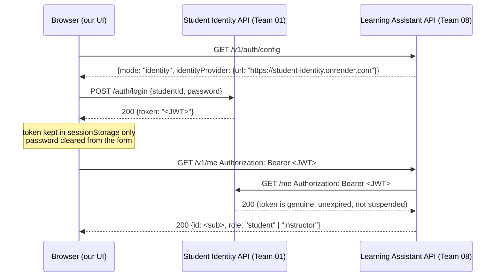

# Cross-Group Integration — Student Identity (Team 01)

Final evaluation evidence for **requirement 3: integration with another group's system (API)**.

The Learning Assistant has **no accounts or passwords of its own**. Every user signs in
with **Student Identity**, the system built by **Team 01**, at
`https://student-identity.onrender.com`. Our API trusts a request only after Team 01's API
confirms the token is genuine.

## 1. Flow



1. **Login happens on Team 01's API.** The password goes straight from the browser to Team 01
   and never reaches our server ([public/app.js](../../public/app.js), sign-in form).
2. **Every API call carries the token** as `Authorization: Bearer <token>`.
3. **We verify it by asking Team 01.** Team 01 publishes no signing keys, so we call their
   `GET /me` with the token. A `200` means the token is genuine. Only then do we use the
   token's `sub` (user ID) and `role`
   ([src/services/identity-client.ts](../../src/services/identity-client.ts)).
4. **Authorization stays ours.** Team 01's role `student` becomes student. `instructor`,
   `staff` or `admin`, or an ID listed in `INSTRUCTOR_IDS`, becomes instructor. Any other
   role gets `403` ([src/middleware/auth.ts](../../src/middleware/auth.ts)).

## 2. Source code

| File | What it does |
|---|---|
| [`src/services/identity-client.ts`](../../src/services/identity-client.ts) | Calls Team 01 `GET /me`: 25 s timeout (their free hosting sleeps), 60 s cache keyed by SHA-256 of the token, discards the profile body |
| [`src/middleware/auth.ts`](../../src/middleware/auth.ts) | `requireAuth` reads the Bearer token, verifies it and maps the role. `requireRole` enforces per-route roles |
| [`src/routes/auth.ts`](../../src/routes/auth.ts) | `GET /v1/auth/config` (tells the UI where to sign in), `GET /v1/me` |
| [`public/app.js`](../../public/app.js) | Sign-in form → Team 01 `POST /auth/login`. Token stored in `sessionStorage` |
| [`wrangler.jsonc`](../../wrangler.jsonc) | `AUTH_MODE: "identity"`, `IDENTITY_API_BASE: "https://student-identity.onrender.com"` |
| [`test/identity-auth.test.ts`](../../test/identity-auth.test.ts) | 11 automated tests for this integration |

## 3. Requests and responses

**Sign in (browser → Team 01)**
```http
POST https://student-identity.onrender.com/auth/login
Content-Type: application/json

{"studentId": "<student id>", "password": "<password>"}
```
```json
200 OK
{"token": "eyJhbGciOi...<JWT with sub, role, exp>"}
```

**Who am I (browser → Team 08 → Team 01)**
```http
GET https://learning-assistant-api.6731503060.workers.dev/v1/me
Authorization: Bearer eyJhbGciOi...
```
```json
200 OK
{"data": {"id": "<sub from token>", "role": "student", "authMode": "identity"}}
```

**Failure cases**

| Situation | Our response |
|---|---|
| No token | `401 UNAUTHORIZED`: "Sign in with Student Identity to continue." |
| Fake, edited or expired token (Team 01 says no) | `401 UNAUTHORIZED`: "Your sign-in is invalid or has expired." |
| Old demo headers (`x-user-role: instructor`) without a token | `401`. The headers are ignored in identity mode |
| Valid token, role we don't recognise | `403 FORBIDDEN` |
| Valid student token calling an instructor route | `403 FORBIDDEN` |
| Team 01 down or answering 5xx | `503 DEPENDENCY_UNAVAILABLE`. We never fall back to letting the user in |

## 4. Automated test evidence

`npx vitest run test/identity-auth.test.ts`, all passing:

- accepts a token Student Identity vouches for and uses its subject and role
- ignores the old x-user headers: claiming instructor without a token gets 401
- rejects a token edited to claim a different role (Student Identity did not vouch for it)
- rejects expired and malformed tokens without calling Student Identity
- answers 503 (not 401) when Student Identity is down
- caches a successful check briefly instead of asking on every request
- maps instructor and staff accounts to instructor, and refuses roles with no mapping
- enforces our own role rules on top: a student token cannot create a source
- INSTRUCTOR_IDS grants instructor rights to specific accounts
- reports Student Identity sign-in by default, and demo headers only when configured
- mapIdentityRole maps Student Identity roles to Learning Assistant roles

## 5. How to show it live

1. Open Team 01's site a few minutes before the demo. Their free hosting sleeps, and the
   first sign-in can take up to a minute.
2. Open our deployed UI, then **DevTools → Network**.
3. Sign in. Show the `POST /auth/login` going to `student-identity.onrender.com` and the
   `token` in its response.
4. Show the next `GET /v1/me` to our Worker carrying `Authorization: Bearer …`, and its
   response with the mapped role.
5. Failure case: run
   ```bash
   curl -i https://learning-assistant-api.6731503060.workers.dev/v1/me -H "Authorization: Bearer not-a-real-token"
   ```
   and show the `401`.

## 6. Coordination

- Team 01 must keep `https://student-identity.onrender.com` running during our evaluation slot.
- Test accounts are Team 01 accounts shared inside the team. They are **not** written in this repo.
