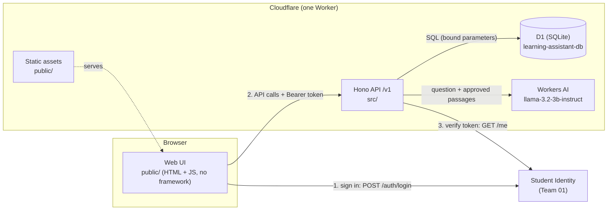
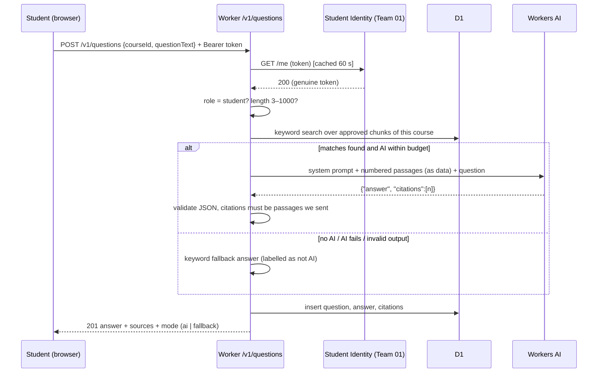
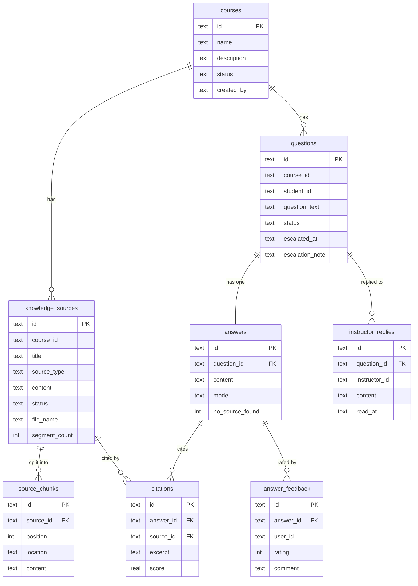

# Architecture — Learning Assistant (Team 08)

Final evaluation evidence for **requirement 4: system architecture and design**.

## 1. What the system does

Students ask course questions and get answers built **only** from instructor-approved
course materials, and every answer cites its sources. Instructors manage courses and
materials and reply to students who still need help.

## 2. Components



| Component | Technology | Why |
|---|---|---|
| Web UI | Plain HTML/CSS/JS in `public/` | Served by the same Worker, so UI and API deploy together. No build step. |
| API | Cloudflare Worker + Hono (TypeScript) | Runs at the edge. Hono is the only runtime dependency. |
| Database | Cloudflare D1 (SQLite) | Relational data with foreign keys and CHECK constraints. Schema lives in numbered migrations. |
| AI | Workers AI (`@cf/meta/llama-3.2-3b-instruct`) | Free daily allocation with no payment method. Cut off after 15 s, with a per-course daily budget. |
| Sign-in | Student Identity (Team 01) | Cross-group integration; see [team01-integration.md](team01-integration.md). |

## 3. Code layout (layered)

```
src/index.ts            wires middleware + routes under /v1
src/middleware/         correlation id → request logger → auth (per route)
src/routes/             HTTP: parse + validate input, check role, shape response
src/services/           logic: AI answer, keyword fallback search, chunking, identity client
src/repositories/       all SQL, always with bound parameters
src/lib/                validation, error shape, structured logger, constants
migrations/             0001 → 0005, applied in order
public/                 web UI (app.js, file-extract.js for PDF/PPTX/DOCX text)
test/                   vitest suites (167 tests)
```

## 4. Request flow: a student asks a question



The answer is never lost: if the AI is turned off, slow (over 15 s), over its daily budget,
or returns output that fails validation, the student still gets a labelled keyword-search answer.

## 5. Data model (after migration 0005)



Supporting tables: `ai_usage` (daily AI budget), `received_events` and
`outbound_webhook_deliveries` (webhook idempotency and delivery log).

| Migration | Adds |
|---|---|
| 0001 | Core tables: sources, questions, answers, citations, feedback, received events |
| 0002 | Outbound webhook deliveries |
| 0003 | AI usage budget |
| 0004 | `source_chunks` (uploaded files split into passages), `instructor_replies`, question escalation |
| 0005 | `courses`. Every source and question now belongs to a course |

`GET /v1/health/ready` checks that every table above exists, so a deployment that
skipped a migration reports `down` instead of `ok`.

## 6. API surface (`/v1`)

| Area | Endpoints | Who |
|---|---|---|
| Health | `GET /health`, `GET /health/ready` | public |
| Auth | `GET /auth/config`, `GET /me` | public / signed in |
| Courses | `GET /courses`, `GET /courses/:id`, `POST /courses`, `PATCH /courses/:id` | read: all · write: instructor |
| Sources | `GET /courses/:id/sources`, `POST /sources`, `PATCH /sources/:id`, `DELETE /sources/:id` (archive) | read: all · write: instructor |
| Questions | `POST /questions`, `GET /questions/:id`, `GET /me/questions` | student asks; only the owner or an instructor can read |
| Help | `POST /questions/:id/escalate`, `POST /questions/:id/replies`, `GET /instructor/inbox` | student / instructor |
| Feedback | `POST /answers/feedback` | rating 1–5, one per user |

The full request collection is in [`postman/`](../../postman/Learning-Assistant-API.postman_collection.json).

## 7. Deployment

- `npm run deploy:khant` publishes UI and API together as one Worker to
  `https://learning-assistant-api.6731503060.workers.dev` (the `khant` environment and its D1 database).
- Remote migrations: `npm run db:migrate:khant` (applies only the missing ones).
- Team members with access to the Cloudflare account can deploy; everyone commits to `main` first.
- Environments in `wrangler.jsonc`: the default (deployed, `AUTH_MODE=identity`), `local`
  (local D1 file, demo sign-in for offline development), and `khant` (a team member's deployment).
